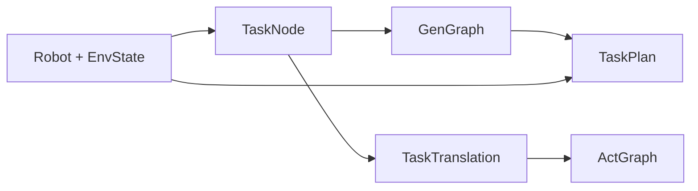

# hybridx.py 数据格式

`hybridx.py` 只定义类型和算法。具体的机器人、环境、任务、态射和翻译写在 `hybridx_apply.py`。

除内部辅助类型外，可展示的对象都带有 `text()` / `print()`，两者输出同一段结构文本。

数据按节号分层：

| 节 | 内容 | 是否在应用文件里实例化 |
| --- | --- | --- |
| 0.1 | 抽象态射 | 否，只是数学工具 |
| 0.2 | 图计算工具 | 否，当前为空 |
| 1.1 | 机器人与环境状态 | 是 |
| 1.2 | 机器人动作态射 | 是 |
| 2 | 基元任务 | 是 |
| 3.1 | 任务 operad 与生成图 | 是 |
| 4 | 任务到动作执行图的翻译 | 是 |
| 5 | 可行方案 | 由求解器生成 |

边的方向一律是「先 → 后」：`u → v` 表示 u 完成之后才能做 v。

---

## 0.1 抽象态射

描述范畴里的一根箭头，不表示机器人的具体动作。机器人动作在第 1.2 节。

### Morphism

| 字段 | 类型 | 含义 |
| --- | --- | --- |
| `mid` | `str` | 态射名称 |
| `src` | `str` | 源对象 |
| `tgt` | `str` | 目标对象 |
| `reliability` | `float` | 成功概率，范围 `[0, 1]`，默认 `1.0` |

`identity(obj)` 得到 `obj` 上的恒等态射，可靠性为 1。

`compose(f, g)` 先做 `f` 再做 `g`，要求 `f.tgt == g.src`。复合可靠性是两者之积。

---

## 1.1 机器人与环境

机型只有两种：`transport`（运输车）、`arm`（机械臂）。

### RobotState

两种机器人的公共状态。

| 字段 | 类型 | 含义 |
| --- | --- | --- |
| `pos` | `(float, float)` | 平面位置 `(x, y)`，单位米 |
| `theta` | `float` | 朝向角，单位弧度 |
| `bat` | `float` | 剩余电量，范围 `[0, 1]` |
| `belief` | `dict` | 对环境的信念，默认为空字典 |

### TransportRobot

继承 `RobotState`。

| 字段 | 类型 | 含义 |
| --- | --- | --- |
| `full` | `float` | 装载量，`0` 空载，`1` 满载，范围 `[0, 1]` |
| `dis` | `float` | 累计行驶里程，单位米，非负 |

### ArmRobot

继承 `RobotState`。

| 字段 | 类型 | 含义 |
| --- | --- | --- |
| `ang` | `(float, float, float)` | 三个关节角 |
| `grip` | `float` | 夹爪，`0` 空，`1` 夹持 |

### Robot

分类层中的一台机器人。`state` 必须与 `rtype` 对应：运输车放 `TransportRobot`，机械臂放 `ArmRobot`。

| 字段 | 类型 | 含义 |
| --- | --- | --- |
| `rid` | `str` | 机器人编号，如 `R1` |
| `rtype` | `str` | `transport` 或 `arm` |
| `state` | `RobotState` | 当前状态 |
| `capability` | `dict[str, float]` | `{任务类型: 能力值}`。求解时，能力值必须不低于任务角色要求的能力 |
| `r0` | `float` | 零距离基准可靠性，默认 `0.99` |
| `lam_r` | `float` | 可靠性随距离的衰减系数，默认 `0.002` / 米 |
| `lam_b` | `float` | 电量随距离的消耗系数，默认 `0.0005` / 米 |

未出现在 `capability` 里的任务类型，求解时按能力 `0` 处理，不能承担该任务。

### EnvState

| 字段 | 类型 | 含义 |
| --- | --- | --- |
| `occ` | `dict` | 栅格占用 |
| `mat` | `dict` | 栅格材质 |
| `sigma` | `dict` | 结构化程度 |

---

## 1.2 机器人动作

每个动作都有 `apply(robot)`，直接改写该机器人的状态。`a1`、`a2`、`a3` 两种车都能用；`m1`、`m2` 只能用于机械臂；`t1`、`t2` 只能用于运输车。

| 类型 | 参数 | 作用在状态上的结果 |
| --- | --- | --- |
| `A1` | `bat_decline_num: float`，且 `≥ 0` | `bat` 减少该值；结果小于 `0` 则拒绝 |
| `A2` | `src`、`dst`，均为 `(float, float)` | 当前 `pos` 必须等于 `src`，执行后变为 `dst`。只改位置 |
| `A3` | `content: dict` | 把 `content` 并入 `belief`。框架不计算公式 |
| `M1` | `src_angle`、`dst_angle`，等长且非空 | 当前关节角必须等于 `src_angle`，执行后变为 `dst_angle` |
| `M2` | `act: 'grasp' \| 'release'` | `grasp` 使 `grip = 1`，`release` 使 `grip = 0` |
| `T1` | `dis_delta_num: float`，且 `≥ 0` | `dis` 增加该值。只改里程 |
| `T2` | `load_num: float` | `full += load_num`。正数装载，负数卸载；结果必须落在 `[0, 1]` |

`a2` 不改变 `dis`，`t1` 不改变 `pos`。

---

## 2 基元任务

一件任务说明：谁来做、开始前必须成立什么、做完后留下什么、必须等哪些任务。

### RobotRole

| 字段 | 类型 | 含义 |
| --- | --- | --- |
| `rtype` | `str` | `transport` 或 `arm` |
| `capability` | `float` | 该机型完成本任务所需的最低能力，范围 `[0, 1]` |

同一 `TaskNode` 里每种 `rtype` 至多出现一次。

### PreCondition

| 字段 | 类型 | 含义 |
| --- | --- | --- |
| `who` | `tuple[str, ...]` | 一个机型，或两个机型。所写机型必须参加本任务 |
| `key` | `str` | 被约束的量 |
| `op` | `str` | `<`、`<=`、`>`、`>=`、`==` 之一 |
| `value` | `float` | 阈值 |

一个机型时，比较该机器人状态上的字段，例如 `('transport',) / full / <= / 0`。

两个机型时，当前求解只计算 `key == 'dist'`，即两台机器人当前位置的欧氏距离，例如 `('arm', 'transport') / dist / <= / 1`。

### PostEffect

| 字段 | 类型 | 含义 |
| --- | --- | --- |
| `target` | `tuple[str, ...]` | `('robot', 机型)` 或 `('env',)` |
| `key` | `str` | 要改的字段，如 `full`、`bat`、`grip`、`pos`、`belief`、`mat`、`occ` |
| `value` | 任意 | 写入的值 |
| `mode` | `str` | `set` 覆盖，`add` 累加，`merge` 合并字典。默认 `set` |

机器人效果里的机型必须参加本任务。`add` 用于电量消耗这类增量，`merge` 用于信念。求解时，`bat` 被减到负数，或运输车 `full` 离开 `[0, 1]`，该方案不可行。

### Dependency

| 字段 | 类型 | 含义 |
| --- | --- | --- |
| `ref` | `str` | 前驱任务的编号或类型 |
| `by` | `str` | `id` 按 `tid` 匹配，`type` 按 `ttype` 匹配。默认 `id` |

这是任务对象上的偏序。求解时会并入第 3.1 节生成图的边。

### TaskNode

| 字段 | 类型 | 含义 |
| --- | --- | --- |
| `tid` | `str` | 任务编号，如 `T_load_A` |
| `ttype` | `str` | 任务类型，如 `load`、`dig` |
| `roles` | `list[RobotRole]` | 参与角色 |
| `pre` | `list[PreCondition]` | 前置条件 |
| `post` | `list[PostEffect]` | 后置效果 |
| `deps` | `list[Dependency]` | 偏序前驱 |

---

## 3.1 生成图

复杂任务是基元（或子任务）的有向无环图。节点之间有边才有依赖；没有路径相连的节点可以并行。

### 被略去的移动

下列类型只出现在书写生成规则时，存入 operad 前会被丢掉，不成为节点：

| 类型 | 含义 |
| --- | --- |
| `move` | 平面移动 |
| `move_ang` | 机械臂姿态变化 |
| `nav` | 二维导航运输 |
| `roadtrans` | 一维道路长途运输 |

相邻基元之间的移动距离用 `move_distance(终点, 起点)` 计算，即两点的欧氏距离。`gap_distances(graph, end_pos, start_pos)` 只对生成图上的直接边计算这段距离。

### GenNode

| 字段 | 类型 | 含义 |
| --- | --- | --- |
| `nid` | `str` | 展开后的节点编号。嵌套形式如 `build/1:deliver/0:load` |
| `ttype` | `str` | 基元类型 |
| `task` | `TaskNode \| None` | 按类型挂上的第 2 节任务；求解要求此处非空 |

### GenGraph

| 字段 | 类型 | 含义 |
| --- | --- | --- |
| `ttype` | `str` | 这张图对应的复杂任务名 |
| `nodes` | `tuple[GenNode, ...]` | 全部基元节点 |
| `edges` | `tuple[(str, str), ...]` | `(先, 后)`，两端都必须是节点编号 |

图中不允许重复节点，也不允许环。`sources()` 是没有前驱的节点，`sinks()` 是没有后继的节点。

### TaskOperad

| 成员 | 类型 | 含义 |
| --- | --- | --- |
| `primitives` | `set[str]` | 已登记的基元类型 |
| `generators` | `dict[str, (步骤元组, 依赖下标元组)]` | 复杂任务名 → 去掉移动后的输入，以及这些输入之间的直接依赖 |

`add_generator(output, steps, deps=None)` 的 `steps` 可以夹带移动类型。`deps` 是去掉移动之后的下标对 `(i, j)`，表示剩余任务 `i` 必须先于 `j`。不传 `deps` 时，只把相邻剩余任务连成一条链。

外层复合只把前一张子图的出口接到后一张子图的入口。例如 `build = carve → deliver → assemble` 展开后，直接边是 `dig → load → unload → grasp → place`，不会把 `dig` 连到 `unload`。

`decompose(ttype, tasks)` 把复杂任务递归展开成只含基元的 `GenGraph`。`tasks` 用任务类型索引 `TaskNode`。

---

## 4 任务翻译

把一个基元类型映射成一张动作执行图。任务名只作为映射的键，不是图中的节点。

### ActNode

| 字段 | 类型 | 含义 |
| --- | --- | --- |
| `nid` | `str` | 动作节点编号，形如 `arm:m1:3` |
| `op` | `str` | 动作名：`a1` `a2` `a3` `m1` `m2` `t1` `t2` |
| `role` | `str` | 执行该动作的机型，`transport` 或 `arm` |

机械臂可用 `a1 a2 a3 m1 m2`。运输车可用 `a1 a2 a3 t1 t2`。

### ActGraph

| 字段 | 类型 | 含义 |
| --- | --- | --- |
| `nodes` | `tuple[ActNode, ...]` | 动作节点 |
| `edges` | `tuple[(str, str), ...]` | 先后边。指向 `a1` 的边是耗电分叉，其余边是主动作的先后 |

`a1` 由 `ActBuilder.node()` 自动挂到每个主动作下面，不放在主链上。`a3` 需要感知时作为主链节点插入。多机器人汇合用 `link(src, dst)` 另加一条边，例如机械臂的 `m2` 指向运输车的 `t1`。

### TaskTranslation

| 字段 | 类型 | 含义 |
| --- | --- | --- |
| `ttype` | `str` | 被翻译的基元类型 |
| `graph` | `ActGraph` | 执行图 |
| `env` | `tuple[PostEffect, ...]` | `R→E` 的环境变化。每条效果的对象必须是 `('env',)`。默认空 |

### TaskTranslator

`table` 的类型是 `dict[str, TaskTranslation]`，键为基元类型。

`translate(task)` 取出对应翻译，并要求任务的角色集合与执行图里出现的机型集合相同。

---

## 5 任务方案

求解器的输入是一台 `TaskSolver` 构造时给定的三样东西：

| 参数 | 类型 | 含义 |
| --- | --- | --- |
| `robots` | `dict[str, Robot]` | 编号 → 机器人。构造时复制，不改调用方的对象 |
| `env` | `EnvState` | 初始环境，同样在构造时复制 |
| `graph` | `GenGraph` | 第 3.1 节展开后的基元依赖图，每个节点的 `task` 必须有值 |

规模由这些参数控制：

| 参数 | 默认 | 含义 |
| --- | --- | --- |
| `beam_width` | `8` | 束搜索每层保留的部分方案数 |
| `robot_limit` | `4` | 每个角色最多尝试的机器人数 |
| `iters` | `120` | 邻域搜索迭代次数 |
| `destroy_ratio` | `0.3` | 每轮拆掉的基元比例 |
| `T0` | `8.0` | 模拟退火初温 |
| `alpha` | `0.97` | 每轮温度衰减 |
| `seed` | `0` | 随机种子 |

### TaskPlan

| 字段 | 类型 | 含义 |
| --- | --- | --- |
| `order` | `tuple[str, ...]` | 基元节点编号的执行顺序，是依赖图的一个线性延伸 |
| `assign` | `dict[str, dict[str, str]]` | 节点编号 → `{机型: 机器人编号}` |
| `travel` | `float` | 被略去的接近移动的总行程，单位米。不可行时为无穷大 |
| `feasible` | `bool` | 是否找到可行方案 |
| `labels` | `dict[str, str]` | 节点编号 → 展示用的 `类型  任务编号` |

一个可行方案同时满足：

- 每个基元的每个角色都分到一台同型机器人，且该机器人在此任务类型上的能力不低于角色要求。
- `order` 覆盖全图，且每个节点的前驱都排在它前面。前驱来自生成图的边，也来自 `TaskNode.deps`。
- 按顺序重放时，先补接近移动，再检查前置条件，然后写入后置效果。电量不为负，运输车装载量留在 `[0, 1]`。

接近移动的规则：后置效果若把某台机器人的 `pos` 设为新点，它先走到该点；若一条 `dist <=` 或 `dist <` 尚未成立，两台机器人走到当前位置的中点。这段路程计入 `travel`，并按该机器人的 `lam_b` 扣电，运输车同时增加 `dis`。
